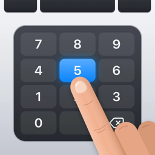
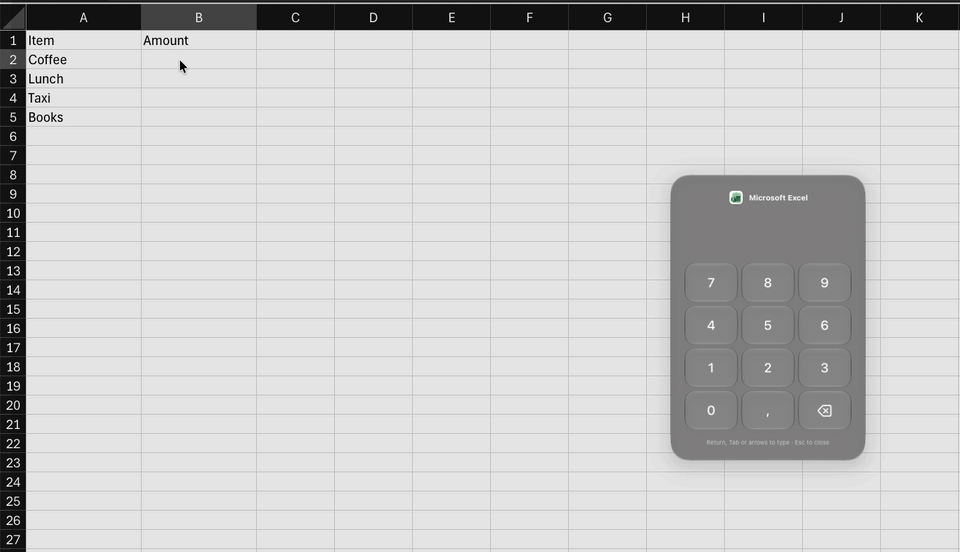

<p align="center">
  
</p>

<h1 align="center">Keypad</h1>

<p align="center">
  <strong>Turn your Mac's trackpad into a numeric keypad.</strong><br>
  Press a shortcut, tap the numbers, and they're typed into the field you were working in.
</p>

<p align="center">
  <a href="https://github.com/berkanaslan/keypad/releases/latest"></a>
  
  <a href="LICENSE"></a>
  <a href="#install"></a>
</p>

---

Most Mac laptops and compact keyboards have no numeric keypad. Keypad turns the trackpad under your hands into one, only while you need it. It works in spreadsheets, invoices, forms, prices: any app, any text field. It's free, open source, and never goes online.

<p align="center">
  
</p>

## Install

With [Homebrew](https://brew.sh):

```bash
brew install --cask berkanaslan/tap/keypad
```

Or download the latest `Keypad-<version>.dmg` from [Releases](https://github.com/berkanaslan/keypad/releases/latest) and drag Keypad to Applications.

**First launch:**
- macOS asks to let Keypad control your computer. Keypad needs this Accessibility permission to type the number into other apps.
- If you dismissed the prompt, open **System Settings › Privacy & Security › Accessibility** and turn Keypad on.
- Keypad starts working as soon as the switch is on. There's no need to reopen it.

Requires macOS 26 Tahoe or later, and a built-in trackpad or a Magic Trackpad.

## How it works

1. Press **⌃⌥K** in any app.
2. Tap numbers on the trackpad. The number appears in a glass panel in the middle of the screen.
3. Press a key on your keyboard to type it:

| Key | What happens |
|---|---|
| Return, ⇧Return, keypad Enter | Types the number, then that key |
| Tab, ⇧Tab | Types the number, then that key: next or previous cell |
| ← ↑ → ↓ | Types the number, then that arrow |
| The shortcut again | Types the number and closes |
| Esc | Closes without typing |

Keypad stays open after Return, Tab or an arrow, ready for the next number, so you can fill a whole spreadsheet column without lifting your hands. A commit with no number still sends its key, so you can skip cells.

## Features

- **Works everywhere:** native apps, browsers, Electron apps and spreadsheets.
- **Your part of the trackpad:** choose which area acts as the keypad. The rest still works as a normal trackpad.
- **Your shortcut:** record two modifiers, one of them ⌘ or ⌃, with a key, or a function key.
- **Feedback you can feel:** four key sounds and three haptic patterns, each switchable.
- **Your decimal separator:** the keypad shows and types `,` or `.` to match your keyboard layout.
- **Stay open or close after typing:** your choice.
- English and Turkish.

## Privacy

Keypad has no network access at all: no analytics, no telemetry, no accounts. It runs in the macOS App Sandbox and keeps its settings on your Mac. It types only the number you entered, and only when you press a commit key. The code is all here to check.

## FAQ

**Why does Keypad need Accessibility access?**
macOS requires it for any app that types into other apps. Keypad uses it only to post the number you entered and the commit key.

**Does it work in password fields?**
No. macOS turns on Secure Input in password fields, and Keypad shows a short notice instead of opening.

**What happens if I open Spotlight or Mission Control?**
The keypad stays open with your number and works again when you come back. It closes when another app becomes active.

**Why isn't it on the Mac App Store?**
App Review rejects apps that use the Accessibility permission to type into other apps (Guideline 2.4.5), and that is exactly what Keypad does. So Keypad is free and open source instead.

**Does it change how my trackpad works?**
Only while the keypad is open. If the keypad uses the whole trackpad, the pointer pauses until it closes. If it uses part of it, slide a finger on the rest to move the pointer, scroll as usual, and click to close the keypad. A click discards a number you haven't typed yet. Esc always closes it.

## Build from source

Requires Xcode 27, which runs on macOS 26.6 or later.

```bash
git clone https://github.com/berkanaslan/keypad.git
cd keypad
swift test --package-path Packages/KeypadKit
xcodebuild -project Keypad.xcodeproj -scheme Keypad -configuration Debug -derivedDataPath build/DerivedData CODE_SIGNING_ALLOWED=NO build
```

The app is in `build/DerivedData/Build/Products/Debug/Keypad.app`. An unsigned build runs, but macOS ties the Accessibility permission to the signature, so you may have to grant it again after each build.

## Contributing

Issues and pull requests are welcome. For anything larger than a fix, open an issue first.
- Every design decision is an [RFC](docs/rfcs/README.md).
- The rules for contributors and AI agents are in [AGENTS.md](AGENTS.md).
- Domain terms are in the [glossary](docs/glossary.md).

## Licence

[MIT](LICENSE) © 2026 Berkan Aslan
